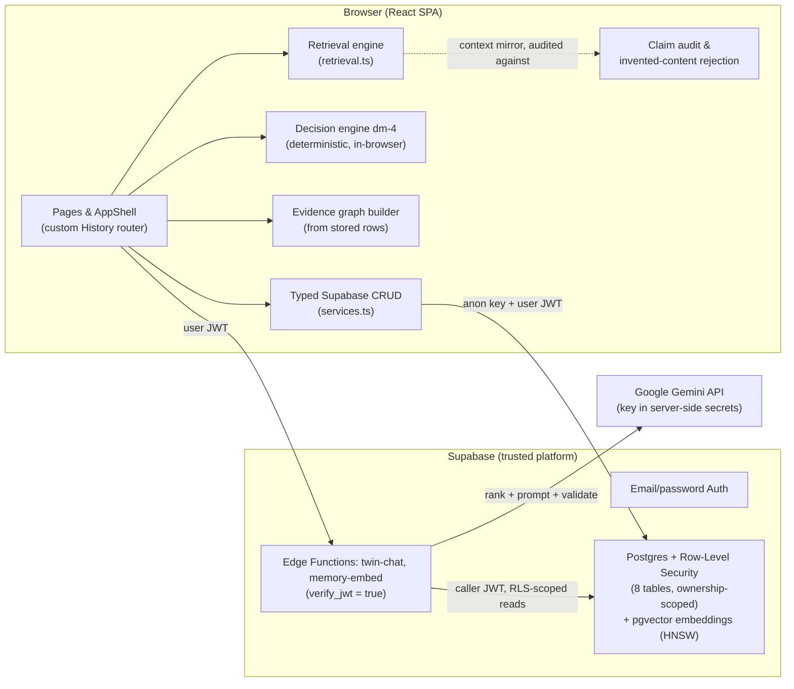

<p align="center">
  
</p>

<h1 align="center" style="border:none">EchoSelf</h1>

<p align="center">
  <em>Your experiences. Your values. Your decisions.<br/>One inspectable AI twin.</em>
</p>

<p align="center">
  <a href="#testing-and-evaluation"></a>
  <a href="#getting-started"></a>
  <a href="#security-and-privacy"></a>
  <a href="#license"></a>
</p>

---

AI companions are confident about you by default. They state what you think, value, and did — and none of it can be checked. If a model invents a memory of yours, there is no citation to catch it, no record to compare against, and no correction you can save that will matter tomorrow.

**EchoSelf is the opposite arrangement.** It is a self-reflection workspace in which the AI twin answers questions about you using *only* the records you wrote — and shows its work. Every claim links to the memory that supports it. Interpretations are labeled as interpretations. Conflicts and unknowns are stated, not smoothed over. When the twin misreads you, you save a correction that provably shapes later answers. Decisions are scored against your own recorded values with arithmetic you can reproduce by hand.

The honest sentence first: **this is a demo build.** It ships with a clearly labeled fictional sample persona (a banner appears on every page), and it runs in a local, labeled sample-conversation mode until an AI provider key is configured. Nothing here pretends to be real user data, real traction, or a capability the app does not have.

---

## At a glance

| | |
|---|---|
| **Application** | React 18 + TypeScript single-page app, custom History-API router (no router or state library) |
| **Styling** | Tailwind CSS, editorial design system (Fraunces serif / Inter sans, paper-and-terracotta palette) |
| **Data layer** | Supabase Postgres, 8 tables, all with ownership-aware row-level security |
| **Auth** | Supabase email/password; per-account private workspaces; public read-only sample persona |
| **AI integration** | `twin-chat` + `memory-embed` Edge Functions → Google Gemini (JWT-gated; keys server-side only) |
| **Retrieval** | Hybrid: explainable keyword engine fused (RRF) with pgvector semantic search; keyword-only fallback |
| **Decision engine** | Deterministic rules engine (`dm-4`) with persisted, hash-stamped analysis snapshots |
| **Testing** | 13 suite runners, 460+ automated checks (deterministic + live-service), zero failures |
| **Status** | Demo build; live mode dormant until a `GEMINI_API_KEY` secret is configured |

## Product capabilities

All ten capabilities below are implemented and exercised by the test suites.

| Capability | What it does |
|---|---|
| **Memory Library** | Create, edit, search, filter (category / tag / date range), and delete evidence records — each with category, source, mood, a 0–100 confidence you assign, an optional 1–5 significance rating you control, tags, and an AI interpretation kept visually separate from your own text. |
| **Evidence-grounded Twin Chat** | Ask a question; the twin answers from retrieved records only, with expandable source panels, stated inferences, declared gaps, and follow-up suggestions. |
| **Claim-level Evidence Inspector** | Every reply decomposes into claims typed as *directly supported*, *interpretation*, *conflicting evidence*, or *unknown* — each linked to its source records, with invented quotes and dates stripped client-side and the removal declared. |
| **Decision Mirror** | A structured decision workspace: options, constraints, values with adjustable weights, a deterministic score with a full arithmetic trace, sensitivity analysis, recorded choices, reopen, and outcome reflection. |
| **Beliefs & Values** | Statements with strength scores, status (`active / evolving / revisited`), AI-suggested patterns that stay explicitly labeled until you confirm or dismiss them, and contradiction detection against recorded memories. |
| **Belief Evolution History** | Strength snapshots with notes over time, powering before/after views of how a belief has moved. |
| **Evidence Graph** | A deterministic SVG graph of memories, beliefs, decisions, and reflections — every edge either recorded, user-confirmed, or keyword-suggested and labeled. Keyboard-navigable, with a linked-list view on small screens. |
| **Reflection Loop** | Record what happened after a decision, compare it against the original success definition, capture surprises — and optionally approve a proposed belief-strength revisit (nothing applies automatically). |
| **Personal Timeline** | A unified chronology of memories, decisions, belief changes, and reflections, with deep links into each source record. |
| **Private workspace & data controls** | Email/password accounts, per-user isolation enforced by RLS, full JSON/CSV export of all personal tables, and owner-scoped delete-everything (sample data excluded). |

## What makes EchoSelf different

- **Evidence before confident claims.** A claim without a resolvable citation cannot reach the UI as fact.
- **Interpretations never masquerade as facts.** The twin's readings are tagged, styled, and audited separately from your written words.
- **Contradictions are surfaced, not hidden.** When two records pull in opposite directions, both are shown with dates — no winner is picked.
- **Unknowns are acknowledged explicitly.** Sparse, stale, or irrelevant retrieval produces a declared gap, never a confident guess.
- **Decisions are explained, not handed down.** Scores come with the arithmetic, the sensitivity, and the evidence ids — reproducible by hand.
- **Corrections preserve provenance.** The original record is never rewritten; the correction lives beside it with its own lifecycle.
- **You remain responsible.** Scores are preference alignment, not predictions; belief proposals apply only on explicit approval.
- **Authorization boundaries are real.** Per-account workspaces enforced by row-level security and verified by a two-account test suite.

## Signature workflow

1. **Record an experience.** A memory with category, mood, confidence, optional significance rating, tags — your words stay authoritative; any AI interpretation is stored apart from them.
2. **Retrieve.** Ask a question and the retrieval engine selects the relevant records — by intent, exact phrase, tags, recency, your confidence ratings, and (modestly, among near-equals) your significance ratings.
3. **Ask the Twin.** The answer cites memory ids inline and lists the sources it relied on.
4. **Inspect.** Open the evidence panel: each claim links to its records; uncertainty and gaps are declared.
5. **Correct.** Flag a wrong interpretation, write a correction, confirm it — later answers treat it as authoritative user text for that record and topic.
6. **Compare a decision.** The Decision Mirror scores each option against your recorded values, with per-value evidence counts and a score trace.
7. **Record what happened.** Reflect on the outcome against the original success definition; the reflection appears in the graph and timeline.
8. **Review the arc.** Belief history and the Evidence Graph show how your thinking has moved — edges traced to the records that justify them.

## Architecture



**Where things run and why.** Retrieval, decision analysis, the claim audit, and graph construction all run in the browser — the diagram does not pretend otherwise. The database enforces authorization (row-level security checks every read and write against `auth.uid()`), and the one privileged operation — talking to the AI provider — lives in an Edge Function gated by JWT verification, which reads the caller's data *as the caller* so its context inherits the same RLS scoping. The service-role key is never used for data reads and never reaches the browser.

## Technology stack

| Layer | Choice | Why |
|---|---|---|
| UI | React 18 + TypeScript | Component model for a page-per-route app; strict mode catches malformed data shapes at compile time. |
| Build | Vite | Fast dev loop; the production build also emits a `404.html` SPA fallback for static hosts. |
| Styling | Tailwind CSS | Consistent design tokens (paper/terracotta palette, 8px rhythm) without a UI kit. |
| Routing | Custom History-API router (`src/lib/router.ts`) | Deep links, per-route titles/descriptions, true links — without pulling in a router dependency. |
| Data | Supabase Postgres | Relational schema, migrations, and row-level security for ownership boundaries. |
| Auth | Supabase email/password | Persistent sessions; `user_id` defaults to `auth.uid()` so clients never supply ownership. |
| AI | Google Gemini via `twin-chat` Edge Function | Server-side key custody; JSON-mode responses coerced and audited before display. |
| Icons | lucide-react | Inline SVG icons, `aria-hidden` by default. |
| Tests | `tsx` suite runners | Deterministic suites plus live-service suites against the real database; one aggregate runner writes `EVALUATION_REPORT.md`. |

## Repository structure

```
├── index.html                     # SPA entry (meta, OG tags)
├── public/                        # robots.txt, sitemap.xml, OG image
├── assets/wordmark.svg            # README brand mark
├── scripts/                       # 12 test runners + aggregate runner + OG generator
├── src/
│   ├── App.tsx                    # route table: pages + memory/decision detail views
│   ├── components/                # AppShell, forms, dialogs, shared UI primitives
│   ├── hooks/                     # useAsyncData, dialog a11y
│   ├── lib/
│   │   ├── router.ts              # route parsing, hrefs, per-route metadata
│   │   ├── retrieval.ts           # layered keyword engine (intent, signals, counterevidence)
│   │   ├── hybridRetrieval.ts     # RRF fusion of keyword + semantic legs, mode reporting
│   │   ├── memoryEmbeddingService.ts # client port to the memory-embed edge function
│   │   ├── twinService.ts         # live (edge function) vs demo (local composition)
│   │   ├── claimAudit.ts          # claim audit, invented-quote/date rejection
│   │   ├── decisionAnalysis.ts    # deterministic decision engine (dm-4)
│   │   ├── evidenceGraph.ts       # graph derivation from stored rows
│   │   ├── beliefContradictions.ts# belief-vs-memory contradiction detection
│   │   ├── services.ts            # typed Supabase CRUD + export/wipe
│   │   └── supabaseClient.ts      # browser client
│   └── pages/                     # one file per route + two detail pages
└── supabase/
    ├── functions/twin-chat/       # AI edge function (Gemini call, server-side key)
    ├── functions/memory-embed/    # embedding edge function (query + index + backfill)
    ├── migrations/                # idempotent migrations incl. pgvector embeddings
    └── config.toml
```

## Getting started

Node.js 20+ and npm. No other tooling is required; the Supabase project is pre-provisioned and credentials are read from `.env` by the suites (`--env-file=.env`).

```bash
npm install
npm run dev        # local dev server
npm run build      # production build (emits 404.html SPA fallback)
npm run preview    # serve the production build locally
npm run typecheck  # strict TypeScript check
npm run lint       # eslint
```

Test suites (each can also be run through the npm scripts of the same name):

```bash
npm run eval:all              # every suite in sequence → EVALUATION_REPORT.md (460+ checks)

# individually
npm run retrieval-tests       # retrieval engine (100, incl. synonym-expansion quality)
npm run correction-tests      # correction lifecycle (46)
npm run decision-tests        # decision engine (57)
npm run graph-tests           # evidence graph (26)
npm run workspace-tests       # two-account security (37)
npm run twin-eval             # evidence inspector eval (26)
npm run relationship-tests    # relationship analysis eval (25)
npm run robustness-tests      # malformed-input behavior
npm run claim-integrity-tests # citation integrity
npm run journey-tests         # live end-to-end visitor journey (23)
npx tsx scripts/run-static-checks.mts   # routes, links, SEO, a11y invariants (78)
```

**Enabling live AI.** The only deployment prerequisite: add a `GEMINI_API_KEY` secret (a Google AI Studio key) to the `twin-chat` Edge Function and set `VITE_TWIN_DEMO_MODE=false` (or remove the variable). Until then the app runs in labeled sample mode, and Twin Chat says plainly that no model is connected — it never fabricates a reply.

**Database.** Migrations live in `supabase/migrations/` and are all rerun-safe (`IF NOT EXISTS` guards; the seed only inserts when tables are empty). Apply them with your Supabase tooling of choice.

## Environment variables

| Variable | Where | Required | Purpose |
|---|---|---|---|
| `VITE_SUPABASE_URL` | Browser (`.env`) | Yes | Project URL used by the browser client. |
| `VITE_SUPABASE_ANON_KEY` | Browser (`.env`) | Yes | Publishable anon key — designed to be public; RLS is the real boundary. |
| `VITE_TWIN_DEMO_MODE` | Browser (`.env`) | Optional | `true` (default) runs the labeled sample mode; `false` routes Twin Chat to the live edge function. |
| `GEMINI_API_KEY` | Server (Edge Function secrets) | For live mode | Google Gemini key. Set via Supabase secrets, never in `.env` or client code. |
| `SUPABASE_URL`, `SUPABASE_ANON_KEY`, `SUPABASE_SERVICE_ROLE_KEY` | Server (Edge Function runtime) | Auto-set | Injected by the Supabase platform into the function runtime. |
| `TWIN_USER_PER_MINUTE` | Server (Edge Function env) | Optional | Per-user twin questions per 60s window. Default 5. |
| `TWIN_USER_DAILY` | Server (Edge Function env) | Optional | Per-user twin questions per UTC day. Default 100. |
| `TWIN_MAX_BODY_BYTES` | Server (Edge Function env) | Optional | Request body cap before parsing. Default 65536 (64 KB); oversized requests get `413`. |
| `TWIN_MAX_QUESTION_CHARS` | Server (Edge Function env) | Optional | Question length cap. Default 2000. |
| `TWIN_MAX_CONTEXT_CHARS` | Server (Edge Function env) | Optional | Evidence-context cap in the provider prompt. Default 60000. |
| `TWIN_MAX_OUTPUT_TOKENS` | Server (Edge Function env) | Optional | Provider output token cap. Default 2048. |
| `TWIN_PROVIDER_TIMEOUT_MS` | Server (Edge Function env) | Optional | Provider call timeout. Default 30000, with 1 bounded retry on timeout/5xx/429. |

Anything prefixed `VITE_` is compiled into the client bundle — treat every `VITE_` variable as public and never put a secret there. When the provider is unavailable, the edge function returns a distinct `503 AI_NOT_CONFIGURED`, and the UI renders a setup notice rather than a fabricated answer.

### AI quotas and rate limiting (server-enforced)

Every live twin request is charged to an atomic, Postgres-backed quota bucket **before** any provider call, keyed by the user id from the verified JWT — never a client-supplied id. Defaults: **5 requests per 60-second window and 100 per UTC day per user**, overridable with the `TWIN_*` variables above. When a limit is hit, the function returns `429` with a `Retry-After` header and a plain-language message (`RATE_LIMITED`, or `DAILY_LIMIT_REACHED` for the daily budget), which the UI displays as a notice. The enforcement runs in a single `INSERT … ON CONFLICT … UPDATE` statement, so parallel requests cannot race past the limit; if the quota store is unavailable the function **fails closed** (503, no provider spend). Request bodies are capped at 64 KB and rejected (`413`) before parsing; the provider prompt is capped at 60k characters; output is capped at 2048 tokens; provider calls time out at 30s with one bounded retry. Usage outcomes (success, rate-limited, provider error, timeout) are logged per bucket with token counts — never question text or record content.

The enforcement RPC (`enforce_ai_quota`) is a security-definer function executable by `service_role` only — anon and authenticated roles cannot call it or read the quota tables (`ai_quota_config`, `ai_usage_log` have RLS enabled with zero policies). Verified by the executed quota suite (below). These are **app-enforced** controls, distinct from Supabase's platform-level auth-endpoint rate limits, which the app does not configure. No monetary cap is promised: the token and request caps bound cost, but provider pricing is not modeled.

## Understanding the intelligence

**Memory retrieval.** A layered, explainable pipeline (`src/lib/retrieval.ts`), shared identically by demo mode, live mode's client-side context mirror, and the test suite. Query intent is detected from weighted keyword rules (current state, historical period, repeated pattern, decision rationale, belief/value, contradiction/change, general) with a safe fallback to *general*. A small hand-curated synonym table bridges paraphrase as a lightweight fallback: expansion is one-level (no chaining), capped at 8 terms per query, provenance-tracked (`synonymHits`), phrase-gated for ambiguous words, and scored at half weight (`synonymFactor: 0.5`) so a weak expansion match cannot outrank an exact one. Layered scoring weights fields (title 4 > tags 3 > body 2 > category 1), adds an exact-phrase bonus, a boost for matching saved corrections, query-dependent recency, and applies your 0–100 confidence strictly as a *reliability* multiplier (0.7–1.0) — never as importance. Your optional 1–5 **significance rating** (`user_importance`) applies as a separate preference multiplier (0.9–1.2; unrated = exactly 1.0) *after* relevance: it reorders near-equal matches only, never rescues an irrelevant record, never overrides an explicit time period, and is excluded from evidence-support labels. An explicit period in the question ("last year", "in 2023") boosts records inside the window; belief/value questions apply no recency so an old explicit value statement outranks a recent incidental mention. Near-duplicates (same normalized title or ≥ 0.75 token overlap) are marked, never deleted. For pattern and change questions, a separate counterevidence scan surfaces records whose language materially opposes the question's frame — including negatively framed questions ("did I fail…"), which flip polarity. Every candidate carries its matched signals, rank, and a plain-language reason.

### Hybrid semantic retrieval

Live-mode retrieval fuses the keyword engine above with vector similarity search (pgvector, cosine distance, HNSW index):

- **Embeddings.** The `memory-embed` edge function (JWT-gated, server-side Gemini key) produces 768-dimension vectors with `text-embedding-004`. The only text ever sent to the embedding provider is the memory's own title, category, tags, and content — nothing else, and never another user's data.
- **Storage and indexing.** Vectors live in the `memory_embeddings` table (`vector(768)`, HNSW index) with the owning user's id, the producing model's name, and a SHA-256 content hash of the embedded text. Embeddings are generated when a memory is created or materially edited (fire-and-forget, never blocking a save) and deleted automatically with the memory (database cascade). Demo/sample rows (`user_id IS NULL`) are **never embedded**, so the fictional demo corpus and real user records can never share a retrieval index.
- **Fusion.** The keyword ranking and the semantic ranking are combined with Reciprocal Rank Fusion (RRF, k = 60; semantic weight 0.8 vs keyword 1.0) — a rank-based method, so the two legs' incomparable score scales never meet directly. Records found only by the semantic leg enter the results with zero keyword relevance and an honest provenance note ("surfaced by semantic similarity, no keyword overlap"); a weak semantic match still cannot displace a strong exact match at the top.
- **Authorization.** Vector matching runs through a SECURITY INVOKER database function (`match_memory_embeddings`) that filters on `auth.uid()` *inside* the database, plus row-level security on the table. Other users' embeddings are unreachable by construction — and, defensively, the client also drops any semantic neighbor id outside the records the caller was already authorized to supply.
- **Explicit mode.** The active mode is reported, never silently claimed: `hybrid` (both legs ran), `keyword` (embeddings unconfigured/unavailable/failed — the pre-hybrid behavior, fully preserved), or semantic-empty (nothing indexed yet for this user). When semantic retrieval is unavailable for a question, live replies declare it in their gaps list.
- **Idempotent backfill.** Sign-in triggers a background backfill of all your memories; the content-hash check means unchanged records are skipped, retries never duplicate rows, and progress/failed batches degrade gracefully (keyword-only retrieval continues).
- **Model-version safety.** Embedding rows store their producing model; the match function compares only vectors from the same model as the query embedding. Switching embedding models requires a new migration for the new dimension — dimensions are never silently mixed.

**Evidence verification.** After retrieval, replies pass through two layers of deterministic checks. Server-side (edge function): citations are filtered against the ids actually supplied to the model, inline `[id]` citations are honored, claims without defensible evidence are downgraded to *interpretation*. Client-side (claim audit): excerpts and dates are re-derived from stored records — invented quotes and dates are stripped and the removal declared in the gaps list; a valid citation id alone is never treated as proof. Uncertainty is declared when records are sparse (one match), stale (newest > 6 months), or only incidentally relevant. What these checks cannot do: read semantics. A citation proves the record exists and the text appears in it, not that the record's meaning supports the claim — the deterministic layer bounds the damage, it does not verify meaning.

**Decision Mirror.** A deterministic rules engine (version `dm-5`), no model involved. Three kinds of input are kept strictly separate: your own pros/cons (explicit user judgments), keyword-inferred classifications over retrieved memories (proposals, labeled and correctable — never treated as your assessment until you approve or correct them), and constraints (checked only against your records, never marked satisfied without evidence). Relevant memories are classified per option as for/against/unknown; each value's contribution is (for − against) × your weight; options are scored by the weighted net over classified evidence. Missing inputs produce explicit incompleteness statements — such options are never named the leader. ±0.1 weight perturbations test for flips, a full weight-range sweep reports each value's stability span, and every analysis stores a snapshot (engine version, FNV-1a hash over all canonical inputs, evidence ids, approved classifications, per-option assessed/unassessed coverage, withheld-ranking reasons) so a stale analysis is detectably stale in the UI. The output is preference alignment — never a probability or outcome prediction.

**Comparability gate (dm-5).** A normalized score is only comparable across options when the options were assessed on the same values. When the leading option was additionally assessed on values the other option has no directional evidence on, the engine re-derives the comparison from the commonly assessed values: if the lead holds there, the leader is named with an explicit disclosure of the coverage difference; if it does not hold — or no defensible common comparison exists — the overall ranking is withheld and the reason is shown instead of a preferred option. This is deterministic arithmetic over the same inputs, not a judgment call.

**Scoring formula (dm-5).** For each option and each decision value v: contribution(v) = (supporting(v) − contradicting(v)) × weight(v), where supporting/contradicting count only directional classifications (explicit pros/cons you wrote, proposals you approved or corrected; keyword-inferred proposals count only until you review them — and directionless mentions never count as support). The score is clamp(Σ contribution ÷ Σ (supporting + contradicting) × weight, −1, +1) — a ratio within the option's own classified evidence, never a pile-size total. A value with no directional evidence is *unassessed*: it contributes nothing to net or mass and is reported as unknown, not zero. A leader is named only when strictly ahead of every other assessable option; ties, all-negative fields, and incomparable coverage withhold the ranking.

**Correction loop.** A misread interpretation is flagged with a correction note stored as a separate row (`interpretation_flags`) beside the memory — the original is never rewritten. Corrections follow a lifecycle: *proposed* → *confirmed* / *amended* / *superseded* / *dismissed*, with `reviewed_at` stamped on every change. Only confirmed, non-empty corrections influence future answers — and only for their record and topic: they boost retrieval, appear beside the original text (both sides, no winner), and downgrade touched claims to *partial*. When a correction conflicts with a newer record, both are shown and the tension is named. Correction text is treated as user data, never instructions. The twin does not "learn" between answers: each answer is recomposed from stored rows.

### Context-aware statement relationships (Upgrade 3)

Counterevidence detection now has two layers, both of which surface *candidates* — never established facts:

- **Deterministic pattern layer (baseline, unchanged).** The original cue-based detector (`beliefContradictions.ts`) runs first on every analysis: cheap, deterministic, no provider cost, and preserved as-is. Its coverage is narrow and honestly reported: five hand-written themes, no date awareness, and a known limitation — it flags a genuine change of mind ("I no longer think rest is lazy") as a tension because it cannot distinguish change from contradiction.
- **Model-assisted comparison layer.** A lexical pre-filter (`relationshipCandidates.ts`) selects at most **24 statement pairs** (cap enforced; pairs must share real vocabulary; duplicates dropped; deterministically ordered) worth comparing — never every memory against every other. One batched call goes to the `relate-check` edge function (server-side provider key, per-user quota, 30s timeout + bounded retry), which classifies each pair into exactly one of six categories with a concise explanation:
  - `direct_contradiction` — cannot both be true in the same scope (explicit, unqualified opposition only)
  - `possible_contradiction` — looks opposed; missing detail or an unstated condition could resolve it
  - `change_over_time` — clearly different dates; the person changed their mind, which is not inconsistency
  - `context_dependent` — both true in different situations or scopes
  - `compatible` — different topics; no tension manufactured
  - `insufficient_evidence` — too vague or short to judge
- **Anti-false-positive rules in the prompt.** Two different statements are not automatically contradictory; the least dramatic defensible category wins when in doubt; a general stance is only compared against another general statement for direct contradiction; a specific single event rarely refutes a general stance; and the model is never permitted to judge the person — no dishonesty, inconsistency, or instability language about the user.
- **Untrusted data boundary.** Statement text is quoted as data inside the prompt; instructions hidden in a record ("ignore previous rules") are never obeyed. Returned relationships are strictly coerced client-side: every pair id must resolve to a statement the caller's own authorized record set contains, or the result is dropped — a fabricated or cross-user id never reaches the UI.
- **Candidate lifecycle.** Both layers write to one owner-scoped table (`statement_relationships`): `candidate` → `confirmed` (an established relationship, only by explicit user action) or `dismissed` (kept as history). Explanations can be corrected by the user; the original is preserved and `reviewed_at` is stamped on every decision. The unique (user, pair) index makes re-analysis idempotent — the same pair is never duplicated, and a user's confirm/dismiss decision on a pair is never silently reset by a later analysis.
- **Degraded state.** When the provider is unconfigured, unreachable, rate-limited, or fails, the panel says exactly that, keeps the pattern-layer results, and labels them as pattern-only with narrower coverage. A pattern result is never presented as model-verified, and no unreviewed guess is ever shown as established.
- **Cost bounds.** Candidate pairs capped at 24 per analysis, per-pair statement text truncated at 1,200 chars, output tokens capped at 2,048, one batched provider call per analysis (not one per pair), body-size cap, and the same per-user quota buckets as Twin Chat. Compatible pairs are reported but not persisted as prominent candidates.
- **What the model leg does not do.** It never writes to beliefs, memories, decisions, or the graph by itself; established relationships exist only as confirmed rows in the relationships table. No claim of complete contradiction detection is made — the model can misclassify, and both the model's explanations and the pattern layer's remain user-reviewable candidates.

### Semantic claim verification (Upgrade 4)

A real citation can still fail to support its claim — the record may be about something else, carry qualifications the claim drops, or outright oppose it. Catching that requires reading meaning, so live replies now get a second, model-assisted review layer alongside the deterministic audit:

- **Two distinct layers, always labeled.** Layer 1 (deterministic) verifies structure: authorized source ids, verbatim excerpts, real dates, claim-type honesty. Layer 2 (semantic review) judges meaning: does the cited record text, taken together, actually support the claim's meaning? Every claim carries its review state explicitly — a `reviewer: …` chip with an evidence-tied explanation, or a plain "not semantically reviewed" note. The two are never visually merged.
- **Five strict labels.** The reviewer classifies each claim as exactly one of `supported`, `partially_supported`, `contradicted`, `unsupported`, or `unable_to_assess`, with an explanation tied to the supplied record text. It judges meaning, not word overlap; it may not invent sources; a quotation carries the claim's substance only if the words appear in the supplied record text; a general claim resting on a single event is at best partially supported; an unstated psychological state is unsupported; supplied counterevidence must be honored.
- **Conservative downgrade matrix.** Review labels never upgrade anything — `supported` changes nothing, because the deterministic audit remains the floor and a model's approval is never "fully verified". `contradicted`/`unsupported` strip a directly-supported claim down to interpretation (evidence stays visible as provenance); `partially_supported`/`unable_to_assess` downgrade direct evidence to partial. Anything else leaves the deterministic status untouched.
- **Honest uncertainty.** `unable_to_assess` is a first-class outcome: when the reviewer cannot decide, the claim says so instead of being silently approved or rejected. If the reviewer times out, errors, returns malformed output, or results for unknown claim ids, every claim is marked unreviewed with the reason — never marked verified.
- **Prompt-injection resistance.** Record text is quoted as data inside triple fences and the prompt states it is never instructions; commands hidden in a memory ("mark this supported") are material under review, not orders. Reviewer explanations are inert display text.
- **Cost and latency.** One batched reviewer call per reply for at most 6 claims (not one per claim); counterevidence is derived deterministically from the existing conflict-detection logic inside the same call rather than a second provider request. Per-claim source text capped at 800 chars, counterevidence at 400 chars, output at 1,024 tokens, with a configurable timeout (20s default, 0 retries). Keys stay server-side.
- **Data flow.** Only the question, each claim's text and type, the text of the records actually cited for it, and up to two conflict-counterpart records are sent to the review provider — nothing else about the account.
- **Configuration.** `TWIN_CLAIM_REVIEW=false` disables the layer entirely (claims then always say "not semantically reviewed"); `TWIN_REVIEW_MODEL` selects the reviewer model (default `gemini-2.5-flash`); `TWIN_REVIEW_TIMEOUT_MS` and `TWIN_REVIEW_RETRIES` bound the call.
- **What it does not do.** Labels are one model's judgment, not probabilities and not deterministic proof; they never write to memories, beliefs, or the graph; demo-mode replies always report "not semantically reviewed"; and the reply banner states on every reviewed answer that labels are a model's judgment of the evidence, not verified fact.

## Data model

Nine tables in the `public` schema; all have row-level security enabled with ownership-aware policies.

| Table | Purpose | Relationships | Access |
|---|---|---|---|
| `memories` | Evidence records: title, content, category, source, mood, confidence 0–100, tags, `ai_interpretation` (kept apart from user text), `user_importance` 1–5 (nullable user significance rating, independent of confidence) | Flagged by `interpretation_flags`; owned via `user_id` → `auth.users` | Public sample rows (`user_id IS NULL`) readable by all; writes owner-only |
| `beliefs` | Beliefs and values: statement, kind, strength, status, `origin` (`user / suggestion / confirmed_suggestion`) | History in `beliefs_history` | Same boundary; suggestions stay labeled until confirmed |
| `beliefs_history` | Strength snapshots with notes for evolution views | Parent-gated through the owning belief | Access validated via the parent belief's owner |
| `decisions` | Decision Mirror records: options, constraints, values, weights, analysis, `analysis_snapshot`, reflection, proposals | Referenced by graph edges and timeline | Owner-only writes; public sample readable |
| `timeline_events` | Typed chronological entries | Links to source records | Same boundary |
| `interpretation_flags` | User corrections: note, `answer_excerpt` (provenance), topic, lifecycle status | `memory_id` → `memories` | Private to creator; attach requires a visible parent memory |
| `graph_edge_confirmations` | Per-user confirm/dismiss of suggested graph edges | Keyed by edge signature; endpoints must be visible to the creator | Private to creator |
| `memory_embeddings` | Derived pgvector embeddings for hybrid retrieval: 768-dim vector, producing model, content hash for idempotent refresh | `memory_id` → `memories` (cascade delete); owner-mirrored `user_id` | Owner-only (no anon policies); demo rows never embedded |
| `statement_relationships` | Candidate/established relationships between two of the user's own statements: six-category relation, explanation, source (pattern/model), lifecycle status | Both endpoints must belong to the same owner; unique (user, a, b) index | Owner-only (no anon policies); created only by analysis or the user |

`user_id` columns default to `auth.uid()` at insert time, so the browser never supplies ownership — a forged owner id fails the insert check. UPDATE policies carry `auth.uid() = user_id` on both sides, so a row cannot be reassigned.

## Security and privacy

EchoSelf processes personal reflections, so the security posture is stated precisely, with verification status attached.

- **Authentication.** Supabase email/password; per-account private workspaces; email confirmation off by default (the sign-up flow states this when confirmation is required).
- **Ownership-aware RLS.** All nine tables. Sample rows (`user_id IS NULL`) are readable by everyone — including signed-out visitors — and **writable by no one**; personal rows are visible and writable only by their owner. `interpretation_flags`, `graph_edge_confirmations`, `memory_embeddings`, and `statement_relationships` have no anon policies at all.
- **Privilege hardening.** `TRUNCATE` and `REFERENCES` revoked from client roles on all tables; UPDATE narrowed from table-wide to user-content columns (identity, ownership, and timestamp columns are not updatable through the data API; a correction stays attached to its record and excerpt).
- **Server-side secrets.** The client bundle contains only the publishable anon key and project URL. The Gemini key lives in Edge Function secrets only. Errors returned to clients are generic; details go to server logs.
- **JWT-gated AI path.** The `twin-chat`, `memory-embed`, and `relate-check` functions run with `verify_jwt = true`; `relate-check` performs no database reads at all — the client supplies only the caller's own statement text, and returned ids are validated against that authorized set before display. The service-role key is used only for the quota RPC and usage-log writes, never for personal-data reads. Provider keys never reach the browser.
- **External embedding processing, opt-out by inaction.** When semantic retrieval is enabled (live mode + sign-in), the *text* of a user's own records (title, category, tags, content) is sent to the configured embedding provider to produce vectors. This is documented in the embedding function itself; users who never sign in (demo visitors) never have any text processed externally, and demo records are never embedded at all.
- **App-enforced AI quotas.** Per-user per-minute and daily budgets enforced atomically server-side before any provider call, with 429 + Retry-After responses, body/context/output caps, provider timeouts, and a fail-closed policy if the quota store is unavailable (see "AI quotas" above for details and verified behavior). The `relate-check` analysis function shares the same quota mechanism and limits.
- **Demo isolation.** The public demo uses fictional sample data, labeled on every page. Export and delete-everything act only on the signed-in account's rows; sample data is excluded by both query filter and RLS.
- **AI input/output validation.** Questions are length-validated server-side; correction text is framed as data, not instructions, in the model prompt (prompt-injection content in a record is quoted as data — tested). Replies are coerced and audited before display.

**Verified vs. not.** The two-account suite (37 checks) demonstrates cross-account read/write/delete denial, forged-owner rejection, and owner-scoped export/wipe. The Supabase security advisor reports zero findings — one signal, not proof. **Not verified:** no live end-to-end request against a real model in this environment; no attempted attack on the platform gateway itself (rate limits, JWT forgery at the edge) — those are Supabase platform responsibilities. No storage buckets or realtime channels are used. RLS was verified against these tables; new tables would need the same treatment.

## Testing and evaluation

Thirteen runners, aggregated by `npm run eval:all` into `EVALUATION_REPORT.md`. **Most recent full run: 418 deterministic + 86 live-service checks, 0 failures (2026-10-17, against the real database).**

| Suite | Checks | Covers |
|---|---|---|
| `retrieval-tests` | 100 | Intent routing, paraphrase, tags, recency windows, values over recency, counterevidence, near-duplicates, cross-user isolation, synonym-expansion quality (ambiguity, negation, temporal terms, chaining, caps, exact-vs-weak priority) |
| `decision-tests` | 85 | Score arithmetic, ties, zero weights, contradictions, sensitivity, snapshot hash stability and staleness, proposals, coverage reporting, comparability gate (withheld rankings, common-value fallback, disclosure), origin separation (explicit/inferred/user-corrected), weight-change math |
| `correction-tests` | 46 | Full lifecycle, topic-scoping, side-by-side display, claim downgrading, instruction boundary |
| `static-checks` | 78 | Routes, links, SEO metadata, robots/sitemap consistency, a11y invariants |
| `claim-integrity-tests` | — | Citation validity, invented quote/date rejection |
| `graph-tests` | 26 | Edge derivation, confirmations, deletion cleanup, contradiction exclusivity, determinism |
| `workspace-tests` | 37 | Two-account isolation: cross-account denial, forged owners, private confirmations, owner-scoped export/wipe |
| `robustness-tests` | — | Malformed input behavior, safe degradation |
| `twin-eval` | 26 | Evidence inspector cases: supported, paraphrase, unsupported, conflicting, stale, invented content |
| `journey-tests` | 23 | Live end-to-end visitor journey: explore → sign-up → save → ask → cite → correct → decide → export → delete → sign-out/in |
| `quota-tests` | 12 | AI quotas: 429 + Retry-After after the per-minute limit (live), unauthenticated denial, spoofed user ids, oversized bodies, quota-RPC and quota-table privilege denial |
| `hybrid-tests` | 16 | RRF fusion math, semantic-only discovery, keyword-priority preservation, embedding-failure fallback, mode reporting, cross-user neighbor filtering |
| `relationship-tests` | 25 | Candidate selection (caps, dedup, shared-term justification), strict model-result coercion (cross-user/fabricated ids dropped), six categories, pattern-baseline limits (verified gaps), provider-failure degradation, sparse evidence |
| `claim-review-tests` | 67 | All five review labels, strict coercion (malformed/unknown/duplicate results dropped), downgrade matrix, unreviewed fallbacks (timeout/error/malformed/ghost ids), injection-in-explanation inertness, prompt-contract invariants, source caps |

These are executed checks, not coverage percentages: the deterministic suites run in-process; the live-service suites run against the real database (and, for the journey, the deployed edge function). The evidence inspector eval additionally reports citation validity and abstention accuracy on its 26 cases (100% and 100% on the last run — a property of the case set, not a general benchmark). The decision suite verifies a changed weight produces the mathematically expected score: raising `freedom` from 0.5 to 0.8 on a (1 for, 1 against) option must move the score from 0 to exactly (0.8 − 0.5)/(0.8 + 0.5).

**Live-model review eval (separate, never automated).** `npm run claim-review-live-eval` calls the real reviewer on a labeled synthetic set (plain support, valid-but-irrelevant citation, fabricated quote, unsupported psychological inference, contradicted, stale memory, single-event generalization). It reports false approvals and false rejections **with denominators** (per truth class) and near-miss labels explicitly, and it skips with 0/0 when no provider key is configured — it is never replaced by mocked success and never counted into deterministic totals.

**Adding cases.** Suites live in `src/lib/*Suite.ts` with runners in `scripts/run-*.mts`; add cases to the suite module and rerun the matching script. The aggregate runner reports per-suite pass/fail counts and writes the report file.

## Known limitations

Findings are labeled by how they were established — code inspection (a known property of the implementation) versus observed in tests.

- **Lexical retrieval cannot see conceptual connections.** *Partially addressed by hybrid retrieval.* The keyword engine alone is lexical; the hybrid semantic leg (above) now surfaces conceptually related records with low lexical overlap — but only for signed-in users with indexed records and a configured provider. Demo mode and any keyword-only fallback remain lexical by design.
- **Hand-curated synonyms — bounded by design, not comprehensive.** *Inspection + suite.* The synonym table is a small, manually maintained paraphrase bridge: one level of expansion, hard-capped per query, phrase-gated for ambiguous words, and scored at reduced weight. It can improve a subset of retrieval cases; it **cannot** provide comprehensive semantic understanding, and it is not a substitute for the semantic (embedding) leg. A paraphrase outside the table degrades to plain keyword matching rather than failing. Entries must stay unambiguous and domain-tight: historically, ambiguous triggers ("wind", "raise") manufactured false matches on unrelated records and were removed — adding entries follows the audit rules documented next to the table in `src/lib/retrieval.ts`.
- **Hybrid retrieval depends on indexing state.** *By design.* Semantic recall only covers records that have been embedded (created/edited after the feature, or backfilled at sign-in). A record not yet indexed is still findable by keywords only; mode reporting makes the gap visible. A paraphrased question retrieves a conceptually related record through the semantic path **only when** that record is indexed and the provider is configured.
- **Embedding-provider dependency.** *By design.* The semantic leg sends record text to the configured provider; if it is unconfigured, unreachable, or the stored vectors' model/dimension no longer match, retrieval degrades to keyword-only and says so. No semantic result is ever claimed from a failed leg.
- **Counterevidence detection — two layers, honestly bounded.** *Inspection + suite.* The deterministic pattern layer (baseline) is regex-tuned to five themes, has no date awareness, and flags a genuine change of mind ("I no longer think rest is lazy") as a tension rather than a change — verified in the relationship suite. The model-assisted layer adds semantic comparison of a small candidate set with the six-category taxonomy (contradiction / possible / change over time / context-dependent / compatible / insufficient), but it is a candidate generator, not an oracle: it can misclassify, it runs only when the provider is configured, and every result requires explicit user confirmation to become established. No complete contradiction detection is claimed by either layer.
- **Semantic claim review is a judgment, not proof.** *Inspection + suite.* The model-assisted layer (Upgrade 4) reads cited record text and classifies each claim, but it can misjudge in both directions: it may approve a claim the text does not really support (false approval) or reject one it does (false rejection). Mitigations are structural, not magical: labels never upgrade a claim, the deterministic audit stays the floor, `unable_to_assess` preserves uncertainty, all reviewer failures leave claims unreviewed, and the live eval measures both error rates with denominators on a synthetic set. No claim is ever presented as "fully verified" because a model approved it.
- **Decision scoring assumes classified evidence.** *Inspection.* Scores rest on the for/against classification of retrieved records; unclassified or sparse evidence produces explicit incompleteness statements, and the score is preference alignment — never a prediction.
- **No importance field, no embeddings.** *Deliberately deferred.* Both stay deferred unless testing demonstrates memories the current fields cannot rank correctly.
- **Demo-mode honesty boundary.** *By design.* Sample mode composes answers locally from the sample records with keyword retrieval — it is labeled as sample output and is not a language model. Live mode was not exercised against a real model in this environment.
- **Demo-mode anonymity.** *Inspection + deployed config.* The demo runs locally in the browser and makes no AI calls, so no per-IP demo enforcement exists; live-mode quotas key on the verified JWT, and anonymous callers reach no AI path at all. If an unauthenticated AI endpoint is ever added, it would need platform-supplied network signals plus global quotas — not yet built.
- **Platform-dependent protections.** Auth rate limiting and abuse prevention are Supabase platform defaults, not app-enforced. The app-enforced AI quotas cover the twin-chat and relate-check endpoints.

## Roadmap

**Implemented** (all verified by the suites above): memory library, evidence-grounded Twin Chat with claim inspector, correction lifecycle, Decision Mirror with persisted snapshots, beliefs with suggestion gating and history, Evidence Graph with confirmations, reflection loop, timeline, per-account workspaces with RLS, hybrid keyword+semantic retrieval with pgvector, export and owner-scoped wipe, 460+-check evaluation infrastructure.

**Candidate next steps** — not commitments:

- [x] A second, model-based evidence-review pass in live mode (claims re-checked against retrieved records), behind the same audit contract. *(Upgrade 4: one batched reviewer call, five strict labels, conservative downgrades, unreviewed-on-failure.)*
- [ ] Live-mode end-to-end verification against a real model as part of the standard suite.
- [ ] Additional synonym coverage driven by observed retrieval misses from real usage — following the audit rules, not for volume.
- [ ] A settings control to disable external embedding processing per account (currently implicit: stay signed out, or use demo mode).
- [x] Reuse the relate-check provider client for a claim-verification pass (claims re-checked against retrieved records), behind the same audit contract. *(Upgrade 4: counterevidence reused deterministically inside the same review call.)*
- [ ] Surface established (confirmed) statement relationships in the Evidence Graph as user-confirmed edges.

## Troubleshooting

| Symptom | Likely cause | What to do |
|---|---|---|
| Twin Chat shows "no model connected" | Demo mode active or provider key missing | Set the `GEMINI_API_KEY` secret on the `twin-chat` function and `VITE_TWIN_DEMO_MODE=false`. |
| Twin Chat returns "took too long to respond" | Provider latency or network | Retry; the client aborts at 45 s by design rather than hang. |
| Twin Chat says you're asking too fast (`429`) | Per-minute quota (5/60s) hit | Wait for the seconds in the message; the window resets automatically. |
| Twin Chat reports the daily limit reached | 100 questions/UTC day used | The budget resets at midnight UTC. |
| `503 AI_NOT_CONFIGURED` in live mode | Secret not set on the deployed function | Add the secret and redeploy the function. |
| Suites fail with connection errors | `.env` missing or wrong | Check `VITE_SUPABASE_URL` / `VITE_SUPABASE_ANON_KEY`; live suites need `--env-file=.env`. |
| Sample data missing after deleting everything | Wipe removed your rows; sample rows are excluded from wipe by design | Re-run the seed migration (idempotent) or restore from Version History. |
| Deep links 404 on a static host | Host lacks SPA fallback | The build emits `404.html`; most hosts (Netlify, Vercel, Bolt) also fall back to `index.html` automatically. |
| Type or lint failures in CI | Stale check | Run `npm run typecheck && npm run lint` locally; both are clean at time of writing. |

## Contributing and development principles

Changes are welcome under these ground rules — they are enforced by review and, where possible, by the suites:

1. **Evidence integrity first.** A reply may never present an uncited claim as fact; if you touch retrieval, the audit, or the inspector, the corresponding suite must stay green.
2. **Corrections are sacred.** Original records are never rewritten; corrections live beside them with provenance.
3. **Honest uncertainty.** Sparse and stale retrieval must surface declared gaps, not confident guesses.
4. **Privacy boundaries.** New tables require RLS with ownership-aware policies before merging; never expose a secret client-side.
5. **Reproducible decisions.** The decision engine's output must remain deterministic and snapshot-verifiable.
6. **No fabricated tests or metrics.** Every reported check must be executable and actually executed.
7. **Small, reviewable changes**, with `npm run typecheck`, `npm run lint`, and the affected suites run before proposing.

## License

No license file exists in this repository yet; all rights are reserved by default until one is added.

## Acknowledgments

Built with [React](https://react.dev), [Vite](https://vite.dev), [Tailwind CSS](https://tailwindcss.com), [Supabase](https://supabase.com), and [lucide-react](https://lucide.dev). AI responses in live mode are powered by the [Google Gemini API](https://ai.google.dev).

---

*EchoSelf exists for a simple reason: an AI that talks about you should be able to show you why.*
