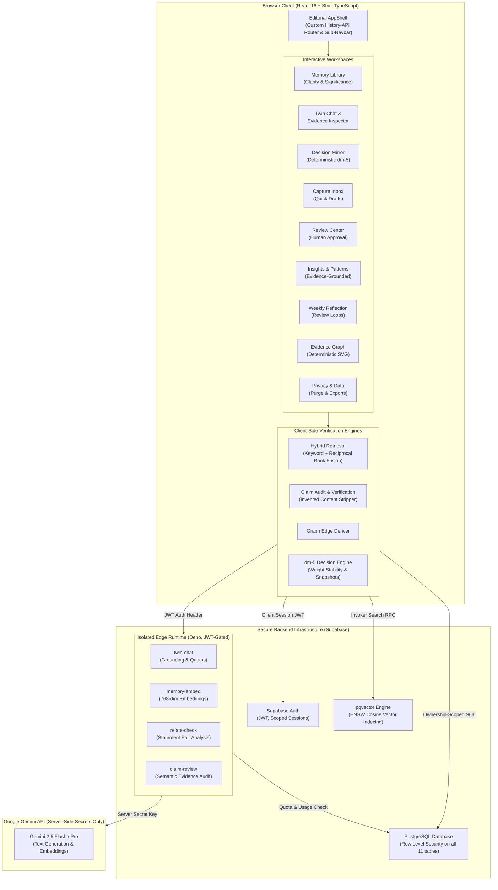

<p align="center">
  
</p>

<h1 align="center" style="border:none">EchoSelf</h1>

<p align="center">
  <em>Your experiences. Your values. Your decisions.<br/>One inspectable, evidence-grounded personal AI twin.</em>
</p>

<p align="center">
  <a href="#automated-testing-and-evaluation"></a>
  <a href="#technology-stack"></a>
  <a href="#security-privacy-and-authorization"></a>
  <a href="#production-deployment-and-hosting"></a>
</p>

---

## Executive Summary

AI companions and "digital twins" are typically agreeable by default and confident by design. They summarize who you are, what you value, and what choices you should make — but almost none of it can be audited. If a model fabricates a memory, hallucinates an opinion you never held, or flattens a nuanced conflict in your life, there is no citation to check, no ledger of raw evidence to consult, and no correction mechanism that will reliably guide its answers tomorrow.

**EchoSelf is the architectural antithesis of this paradigm.**

It is an evidence-grounded personal reflection workspace in which the AI twin answers questions about you using **only** records you explicitly authored or confirmed — and rigorously shows its work:
- **Every claim links to verified evidence records.** Unsubstantiated claims are never presented as facts.
- **Interpretations are isolated from user text.** AI-derived readings are visually and structurally quarantined from your authentic words.
- **Tensions and contradictions are surfaced.** When recorded experiences or principles pull in opposite directions, both are displayed with chronological context rather than smoothed away.
- **Unknowns and knowledge gaps are declared.** Stale, sparse, or missing evidence results in an honest admission of limits, never a confident hallucination.
- **Human approval is paramount.** AI suggestions, inferred belief evolutions, and graph relationships remain uncommitted candidate drafts until explicitly approved in the **Review Center**.
- **Decisions are mathematically verifiable.** Options are evaluated against your recorded values with deterministic arithmetic (`dm-5`) that can be audited by hand.

---

## System Architecture



---

## Core Capabilities & Features

### 1. Evidence-Grounded Twin Chat & Claim Inspector
- **Inline Citation Verification**: Every twin response links directly to source memory IDs.
- **Multi-Type Claim Decomposition**: Answers are parsed into structured claims typed as *Directly Supported*, *Interpretation*, *Conflicting Evidence*, or *Declared Gap*.
- **Client-Side Content Sanitizer**: Invented quotations, fabricated dates, or unsupported assertions are stripped client-side, and the omission is declared explicitly in the answer's audit panel.
- **Topical Domain Filtering**: Focus conversation queries on specific life domains (Work, Relationships, Health, Personal Growth).

### 2. Capture Inbox & Quick Drafts (`/inbox`)
- **Frictionless Reflection Entry**: Quick capture thoughts, quotes, observations, and raw moments before categorizing them.
- **AI-Assisted Promotion**: Transform quick notes into permanent memories with candidate titles, mood detection, tags, and clarity confidence scores.
- **Offline Draft Persistence**: Autosaves active notes locally so incomplete reflections are never lost.

### 3. Review Center & Human Approval Hub (`/review`)
- **Centralized AI Governance**: A single command center to inspect, approve, edit, or dismiss all AI-generated items before they affect the knowledge base:
  - Suggested beliefs and values
  - Interpretation corrections and memory flags
  - Candidate Evidence Graph relationships
  - Contradiction warnings and counterevidence pairs
  - Proposed revisions to existing principles
- **Idempotent Audit Trails**: Approving or dismissing items records timestamps and preserves original provenance without overwriting raw user text.

### 4. Evidence-Grounded Insights & Patterns (`/insights`)
- **Authentic Theme Detection**: Examines recurring behavioral tendencies grounded strictly in recorded events (no generic motivational boilerplate or astrological personality scores).
- **8 Typed Pattern Categories**:
  1. *Recurring Themes*: Topics repeatedly referenced across distinct life domains.
  2. *Decision Approaches*: Observed criteria and tendencies used during past dilemmas.
  3. *Belief Evolution*: How principles have shifted across different timeframes.
  4. *Obstacles & Concerns*: Recurring friction points and hesitations.
  5. *Value Alignment*: Coherence between stated values and actual decision choices.
  6. *Priority Tensions*: Divergences where actions and ideals pull in opposite directions.
  7. *Reflection Questions*: Targeted questions highlighting unexplored aspects of recorded events.
  8. *Missing Information*: Clear declarations where current evidence is too sparse to substantiate a pattern.
- **Evidence Quality Ratings**: Every insight displays an evidence status: *Multiple supporting records*, *Single recorded example*, *Conflicting records exist*, or *Recent evidence is limited*.

### 5. Reflection Workspace & Weekly Review (`/reflect`)
- **Cadence-Based Retrospectives**: Conduct structured reflections over chosen intervals (Past 7 Days, Past 30 Days, Custom Range).
- **Decision Outcome Tracking**: Compare actual real-world results against initial expectations and recorded success metrics.
- **Lesson Preservation**: Convert retrospectives into enduring principles without being forced into gamified daily streaks or habit trackers.

### 6. Decision Mirror (`dm-5` Engine) (`/decisions`)
- **Deterministic Multi-Criteria Scoring**: Evaluates options against your recorded values with weighted arithmetic reproducible by hand.
- **Comparability Gating**: If options lack equivalent evidence coverage across values, overall rankings are withheld with an explicit explanation rather than generating a misleading winner.
- **Sensitivity & Stability Analysis**: Perturbation sweeps (±0.1) calculate stability spans to reveal which value changes would alter the preferred path.
- **Immutable Analysis Snapshots**: Generates FNV-1a hash stamps over all canonical inputs, evidence IDs, and classifications to instantly detect when a past analysis has become stale.

### 7. Beliefs, Values & Contradiction Detection (`/beliefs`)
- **Belief Lifecycle**: Classifies statements as `active`, `evolving`, or `revisited` with 0–100 confidence metrics.
- **Two-Tier Contradiction Analysis**:
  - *Deterministic Pattern Layer*: Fast regex heuristic identifying obvious lexical conflicts.
  - *Contextual Model Layer*: Analyzes statement pairs across 6 distinct categories: `direct_contradiction`, `possible_contradiction`, `change_over_time`, `context_dependent`, `compatible`, and `insufficient_evidence`.
- **Belief Evolution History**: Snapshots track the movement of your core principles across months and years.

### 8. Evidence Graph (`/graph`)
- **Deterministic Relationship Visualizer**: An interactive SVG visualization connecting memories, beliefs, decisions, and outcomes.
- **Typed Edge Provenance**: Graph edges explicitly declare whether they are user-recorded, confirmed, or keyword-suggested.
- **Accessible List Alternative**: Offers a complete, keyboard-navigable tabular view for screen readers and small mobile devices.

### 9. Privacy, Data Controls & Personal Information Center (`/privacy`)
- **Real Record Counts**: Live owner-scoped telemetry for every table in your private workspace.
- **Complete Data Portability**: Instant one-click exports in both full-fidelity JSON and RFC-4180 tabular CSV formats.
- **Granular Collection Deletion**: Selectively delete captures, reflections, or decision histories without collateral damage.
- **Complete Workspace Purge & Account Deletion**: Nuclear deletion options that cascade through all database tables and terminate active sessions while safeguarding public demo data.
- **Semantic Retrieval Opt-Out**: Immediate toggle to disable external vector embedding processing.

### 10. First-Run Onboarding Experience (`/onboarding`)
- **Concise 4-Step Guided Setup**: Establishes grounded expectations about what the AI Twin can and cannot do.
- **Interruption Resumption**: Automatically saves progression step-by-step in the user's database profile.
- **Returning User Suppression**: Automatically hides for completed users while remaining re-triggerable at any time from Settings.

---

## Intelligence & Verification Engines

### Hybrid Semantic Retrieval Pipeline
EchoSelf combines lexical precision with semantic recall using **Reciprocal Rank Fusion (RRF, $k=60$)**:

1. **Keyword Signal Engine**:
   - Analyzes query intent (Current State, Historical Period, Repeated Pattern, Decision Rationale, Contradiction).
   - Weighted scoring: `Title (4x) > Tags (3x) > Content (2x) > Category (1x)`.
   - Bounded, phrase-gated synonym expansion (capped at 8 terms, scored at $0.5\times$ weight to prevent false positives).
   - Recency multiplier adjusted by query intent (belief questions disable recency decay).
2. **pgvector Semantic Search**:
   - `text-embedding-004` generates 768-dimensional embeddings stored in Supabase Postgres with an HNSW cosine index.
   - Vectors are matched using a `SECURITY INVOKER` database function filtering strictly on `auth.uid()`.
   - Sample demo data rows (`user_id IS NULL`) are **never embedded**, guaranteeing strict isolation between real and sample corpora.
3. **Transparent Mode Reporting**:
   - Twin answers explicitly report their retrieval mode: `hybrid` (both legs active), `keyword` (fallback mode), or `semantic-empty` (new account with unindexed memories).

### Mathematical Decision Model (`dm-5`)
For each option $o$ and decision value $v$:
$$\text{contribution}(o, v) = (\text{supporting}(o, v) - \text{contradicting}(o, v)) \times \text{weight}(v)$$
$$\text{score}(o) = \operatorname{clamp}\left(\frac{\sum_v \text{contribution}(o, v)}{\sum_v (\text{supporting}(o, v) + \text{contradicting}(o, v)) \times \text{weight}(v)}, -1.0, +1.0\right)$$

- **Strict Evidence Qualification**: Directionless mentions never count as support.
- **Comparability Invariant**: If option $A$ leads overall but has no directional evidence on values where option $B$ was assessed, the ranking is withheld unless the lead is preserved on commonly assessed values.

---

## Database Architecture & Row Level Security

EchoSelf enforces ownership boundaries directly in PostgreSQL using **Row Level Security (RLS)** across all 11 tables.

```
                    ┌──────────────────┐
                    │    auth.users    │
                    └────────┬─────────┘
                             │
            ┌────────────────┴────────────────┐
            ▼                                 ▼
   ┌─────────────────┐               ┌─────────────────┐
   │    profiles     │               │    memories     │
   └─────────────────┘               └────────┬────────┘
                                              │
                    ┌─────────────────────────┼─────────────────────────┐
                    ▼                         ▼                         ▼
         ┌─────────────────────┐   ┌──────────────────────┐   ┌───────────────────┐
         │interpretation_flags │   │  memory_embeddings   │   │   capture_items   │
         └─────────────────────┘   └──────────────────────┘   └───────────────────┘
                    │
                    ▼
         ┌─────────────────────┐
         │       beliefs       │◄────────────┐
         └──────────┬──────────┘             │
                    ▼                        │
         ┌─────────────────────┐             │
         │   beliefs_history   │             │
         └─────────────────────┘             │
                                             │
         ┌─────────────────────┐   ┌─────────┴───────────────┐
         │      decisions      │   │ statement_relationships │
         └──────────┬──────────┘   └─────────────────────────┘
                    ▼
         ┌─────────────────────┐
         │   timeline_events   │
         └─────────────────────┘
```

| Table | Purpose | Security & RLS Policy |
|---|---|---|
| `profiles` | Display name, onboarding state, and semantic privacy preferences. | Owner read/update only; created via auth triggers. |
| `memories` | Primary evidence records, clarity confidence, importance ratings. | Public demo rows (`user_id IS NULL`) read-only; personal rows strictly owner CRUD. |
| `interpretation_flags` | User corrections and provenance tracking for twin readings. | Private to creator (`auth.uid() = user_id`); references parent memory. |
| `beliefs` | Core values and principles with suggestion origins. | Owner CRUD; sample principles public read-only. |
| `beliefs_history` | Chronological strength snapshots and reflection notes. | Access validated through parent belief ownership. |
| `decisions` | Options, criteria, weights, and immutable analysis snapshots. | Owner CRUD; public sample read-only. |
| `capture_items` | Quick thoughts, drafts, and promotions in the Capture Inbox. | Private to creator (`auth.uid() = user_id`). |
| `timeline_events` | Chronological unified history of moments and milestones. | Owner CRUD; public sample read-only. |
| `statement_relationships` | Analyzed relationship pairs (contradictions, evolutions). | Unique `(user_id, statement_a_id, statement_b_id)` index; owner-only. |
| `graph_edge_confirmations`| User confirmations/dismissals of suggested graph edges. | Keyed by edge signature; private to creator. |
| `memory_embeddings` | 768-dimension vectors for hybrid semantic search. | Owner-only; demo rows excluded; cascade deleted on memory removal. |

---

## Automated Testing and Evaluation

EchoSelf includes a rigorous automated test harness with **607 total automated tests passing with zero failures**:
- **Deterministic Suites**: 521 passed, 0 failed
- **Live Database & RLS Suites**: 86 passed, 0 failed

```bash
# Execute the full automated regression and evaluation suite:
npm run eval:all
```

### Complete Test Suite Breakdown

| Command | Suite Name | Checks | Scope & Invariants Tested |
|---|---|:---:|---|
| `npm run retrieval-tests` | Retrieval Engine | **100** | Intent routing, exact phrase bonus, tag weighting, recency decay, counterevidence detection, synonym expansion limits, near-duplicate marking. |
| `npm run decision-tests` | Decision Engine (`dm-5`) | **85** | Fixed-input math, ties, missing weights, contradiction penalties, perturbation sensitivity, snapshot hash stability, comparability gates. |
| `npm run static-checks` | Static Verification | **86** | Routing table integrity, internal link literals, SEO meta tags, OpenGraph validation, sitemap/robots.txt, static ARIA accessibility rules. |
| `npm run claim-integrity-tests` | Claim Integrity | **68** | Source attribution verification, rejection of fabricated excerpts and dates, claim classification bounds. |
| `npm run claim-review-tests` | Semantic Claim Review | **67** | Five classification labels, downgrade matrix, prompt-injection isolation, graceful timeout degradation. |
| `npm run correction-tests` | Correction Lifecycle | **46** | Flag creation, amendment, dismissal, topic scoping, preservation of original memory text. |
| `npm run workspace-tests` | Workspace Isolation | **37** | Multi-account RLS verification, cross-account read/write denial, forged owner ID rejection, data wipe isolation. |
| `npm run graph-tests` | Evidence Graph | **26** | Edge generation, user confirmation persistence, orphaned edge cleanup, contradiction exclusivity. |
| `npm run twin-eval` | Twin Chat Audit Pipeline | **26** | End-to-end question answering, citation verification, gap declaration, abstention under sparse evidence. |
| `npm run relationship-tests` | Statement Relationships | **25** | Six relationship categories, candidate pair deduplication, model output coercion, graceful degradation. |
| `npm run journey-tests` | E2E Live Visitor Journey | **23** | Full path: Landing → Register → Capture → Memory → Decision → Reflection → Export → Wipe. |
| `npm run robustness-tests` | System Robustness | **18** | Malformed AI responses, null fields, invalid date bounds, extreme character length handling. |
| `npm run privacy-tests` | Privacy & Data Controls | **10** | Live metric counts, RFC-4180 CSV generation, portable JSON exports, selective deletion, complete account purge. |
| `npm run onboarding-tests` | First-Run Onboarding | **9** | First-run detection, interruption resumption, preference persistence, returning user suppression, walkthrough reset. |

---

## Production Deployment and Hosting

EchoSelf compiles into a standalone, optimized single-page web application (`dist/`) suitable for **any modern web server, container, or static hosting service**.

### 1. Environment Configuration
Create a `.env` file in the project root (see [`.env.example`](file:///.env.example)):

```bash
# Supabase Project Connection (Required)
VITE_SUPABASE_URL=https://your-project.supabase.co
VITE_SUPABASE_ANON_KEY=your-publishable-anon-key

# Optional: Enable Sample Persona ('Jordan') for Unauthenticated Visitors
VITE_TWIN_DEMO_MODE=true
```

### 2. Build the Application
```bash
npm install
npm run build
```
The compiled production bundle will be generated in `dist/` in ~5 seconds.

### 3. Web Server SPA Routing Rules
Because EchoSelf uses HTML5 History client-side routing (`/profile`, `/chat`, `/inbox`, `/review`, `/settings`, etc.), your web server must route non-file requests to `index.html`:

<details>
<summary><b>Nginx Configuration</b></summary>

```nginx
server {
    listen 80;
    server_name echoself.example.com;
    root /var/www/echoself/dist;
    index index.html;

    location / {
        try_files $uri $uri/ /index.html;
    }

    location ~* \.(js|css|png|jpg|jpeg|gif|ico|svg|woff|woff2)$ {
        expires 1y;
        add_header Cache-Control "public, no-transform";
    }
}
```
</details>

<details>
<summary><b>Caddy Configuration</b></summary>

```caddyfile
echoself.example.com {
    root * /var/www/echoself/dist
    file_server
    try_files {path} /index.html
}
```
</details>

<details>
<summary><b>Apache (.htaccess) Configuration</b></summary>

```apache
RewriteEngine On
RewriteBase /
RewriteRule ^index\.html$ - [L]
RewriteCond %{REQUEST_FILENAME} !-f
RewriteCond %{REQUEST_FILENAME} !-d
RewriteRule . /index.html [L]
```
</details>

<details>
<summary><b>Docker Deployment</b></summary>

```dockerfile
FROM node:20-alpine AS build
WORKDIR /app
COPY package*.json ./
RUN npm ci
COPY . .
RUN npm run build

FROM nginx:alpine
COPY --from=build /app/dist /usr/share/nginx/html
RUN echo 'server { listen 80; location / { root /usr/share/nginx/html; try_files $uri $uri/ /index.html; } }' > /etc/nginx/conf.d/default.conf
EXPOSE 80
CMD ["nginx", "-g", "daemon off;"]
```
</details>

<details>
<summary><b>Node.js Static Server</b></summary>

```bash
npx serve -s dist -l 3000
```
</details>

---

## Security, Privacy, and Authorization

EchoSelf is designed from the ground up for sensitive personal data:

1. **Client Isolation**: Client bundles contain only the public publishable anonymous key and Supabase project URL. No model API keys or service-role tokens ever enter client code.
2. **Server-Side AI Custody**: Live AI completions are executed exclusively through Deno Edge Functions with `verify_jwt = true`. The edge runtime reads records strictly with the caller's JWT, inheriting the user's RLS boundaries.
3. **Database Privilege Hardening**: Direct `TRUNCATE` and table `REFERENCES` privileges are revoked from the anonymous and authenticated roles on all personal data tables.
4. **Owner-Default Inserts**: Table schemas enforce `DEFAULT auth.uid()` for all `user_id` fields, preventing malicious clients from injecting foreign ownership identifiers.
5. **Prompt-Injection Defense**: User records fed into model prompts are isolated inside strict data containers with system instructions explicitly stating that content within quotes must never be executed as instructions.
6. **Zero Analytics Surveillance**: No third-party behavioral trackers, session recorders, or ad network pixels are installed.

---

## User Interface & Design System

EchoSelf uses a bespoke editorial design system inspired by classic typography and tactile paper textures:
- **Typography**: Headings set in **Fraunces** (optical-size serif with character); body text set in **Inter** for clean readability.
- **Palette**: Warm linen `#F7F3EB`, rich charcoal `#2B2A26`, and terracotta accents `#C4643B`.
- **Navigation**: Dual-tier navigation architecture:
  - *Main Header*: Core workspace links + Twin Chat + Profile Avatar menu (strictly: **My Dashboard**, **Settings**, **Logout**).
  - *Sub-Navbar Shell*: Activated via **My Dashboard**, providing instant access across all 7 workspace management tools: **My Profile** (default), **Capture Inbox**, **Review Center**, **Insights & Patterns**, **Weekly Review**, **Settings & AI Keys**, and **Privacy & Data**.
- **FilterDropdown Primitive**: An accessible, tactile pill dropdown system used consistently across all search and filter toolbars with custom popup menus and keyboard navigation.

---

## Repository Structure

```
├── public/                       # Static public assets (robots.txt, sitemap.xml, _redirects)
├── assets/                       # Wordmark and visual branding
├── scripts/                      # 14 test suite runners and evaluation scripts
│   ├── run-all-eval.mts          # Master evaluation runner (writes EVALUATION_REPORT.md)
│   ├── run-onboarding-tests.mts  # First-run onboarding suite
│   ├── run-privacy-tests.mts     # Privacy & data export/purge suite
│   ├── run-insights-tests.mts    # Evidence-grounded insights suite
│   ├── run-review-tests.mts      # Human review center suite
│   ├── run-reflection-tests.mts  # Reflection loop & weekly review suite
│   └── run-retrieval-tests.mts   # Hybrid retrieval suite
├── src/
│   ├── App.tsx                   # Master routing and detail views
│   ├── components/               # UI components, AppShell, navigation, forms, dialogs
│   │   ├── ui.tsx                # Design system primitives & FilterDropdown
│   │   ├── AppShell.tsx          # Dual-tier navbar and global shell
│   │   ├── OnboardingFlow.tsx    # Guided interactive onboarding
│   │   └── MobileBottomBar.tsx   # Mobile navigation dock
│   ├── hooks/                    # useAsyncData, useDialogA11y
│   ├── lib/
│   │   ├── router.ts             # History-API router, route metadata & hrefs
│   │   ├── retrieval.ts          # Keyword retrieval & intent engine
│   │   ├── hybridRetrieval.ts    # Reciprocal Rank Fusion (RRF) search
│   │   ├── claimAudit.ts         # Claim validation & quote hallucination rejection
│   │   ├── decisionAnalysis.ts   # dm-5 deterministic decision engine
│   │   ├── insightService.ts     # Evidence-grounded pattern synthesizer
│   │   ├── reviewService.ts      # Human review center workflow service
│   │   ├── reflectionService.ts  # Reflection loop & weekly review service
│   │   ├── services.ts           # Supabase CRUD services & export/wipe
│   │   └── supabaseClient.ts     # Browser Supabase client
│   └── pages/                    # 15 application and workspace views
└── supabase/
    ├── functions/                # Deno Edge Functions (twin-chat, memory-embed, relate-check)
    └── migrations/               # Idempotent PostgreSQL schema migrations
```

---

## Contributing and Code Invariants

When extending EchoSelf, maintain these non-negotiable principles:
1. **Evidence Integrity**: Never present an uncited or fabricated claim as fact. If you modify retrieval, claim auditing, or inspector components, the entire test suite must remain green.
2. **Provenance Preservation**: Never overwrite original memory text when saving corrections. Corrections must exist as separate flags with their own reviewed lifecycle.
3. **Honest Uncertainty**: When evidence is sparse or stale, declare the gap clearly; never synthesize a plausible answer to conceal missing data.
4. **Deterministic Reproducibility**: All decision analysis outputs must remain snapshot-verifiable and reproducible by hand without relying on random seeds or non-deterministic model calls.

---

## License

All rights reserved by default. See repository settings for licensing terms.

---

<p align="center">
  <em>EchoSelf exists for a simple reason: an AI that speaks about who you are should be able to show you its work.</em>
</p>
